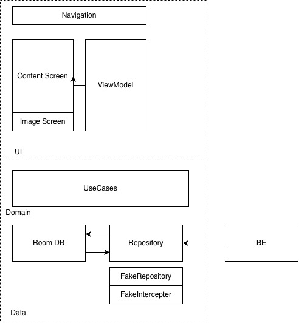

A single-module Android app that renders a backend content document: a list of pages, each
containing a recursive tree of sections, text, images, and single/multi-select choice items.
Content is fetched once, persisted in Room as the single source of truth, and rendered from the
local database so the UI keeps working offline.

## Tech stack

- **Language/Build/SDK:** Kotlin 2.2.10, Gradle 9.6.0, AGP 9.4.1, compileSdk/targetSdk 37, minSdk 30
- **UI:** Jetpack Compose, Material 3
- **Persistence:** Room
- **Networking:** Retrofit, OkHttp, kotlinx.serialization
- **Async:** Kotlin Coroutines / Flow
- **Images:** Coil
- **Testing:** JUnit 4, Robolectric, MockWebServer, Compose UI Test, Navigation Testing, coroutines-test
- **Dependency Injection:** Hilt

## Approach

Clean style layered, offline-first.

Room is the single source of truth.

Repository pattern so we can use fake repositories.

Failures are values, not exceptions.

Wire format is defensive.

Type safe navigation routes.

## Build and run

```bash
./gradlew :app:assembleDebug        # debug APK, works without a backend
./gradlew :app:installDebug         # install on a connected device/emulator
./gradlew :app:testDebugUnitTest    # JVM tests (Robolectric, MockWebServer, Compose)
./gradlew ktlintCheck               # style check
./gradlew ktlintFormat              # auto-fix style
```

Open the project in Android Studio and run the `app` configuration; no API key is needed for a debug
build, which fetches its content from the public document described below.

## Content source

`BASE_URL` points at a public JSON document
(`https://gist.githubusercontent.com/aruana-lumiform/383e1291df3e0cc1d49aeb14d45f5b94/raw/`), and
`ContentApi` requests `lumiform-android-test.json` from it. The document is fetched once, persisted in
Room, and rendered from the database afterwards. It is a static file on GitHub's CDN, not a service:
one `GET`, no query parameters, no authentication.

## Local responses in debug builds

The real HTTP path is the default, but `FakeContentInterceptor` can answer the content request from
`app/src/debug/assets/content_pages.json` instead. Enable it with `USE_FAKE_CONTENT = true` in
`app/build.gradle.kts` when no network is available, or for a demo that must render instantly. Release
builds have no such binding. Since the fixture ships inside the APK, clearing app data does not remove
it: the next launch re-seeds Room from the asset.

I followed a similar approach to the one used in the [Now in Android](https://github.com/android/nowinandroid)
repository, wiring the `FakeContentInterceptor` through `DebugNetworkModule` so it is contributed to the
OkHttp client's interceptor set via Hilt only in the `debug` source set.

The fixture is kept as an offline fallback because the content source is a single static document, and
the app only needs to support JSON responses.

## Continuous integration

GitHub Actions runs the checks in `.github/workflows/ci.yml` on every push to `master` and on pull
requests targeting `master`.
## High Level Architecture



**Note:** I've also included my skills and prompts for this repository to show my thought process.
